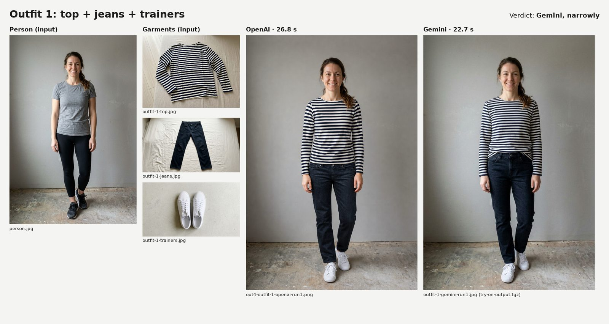
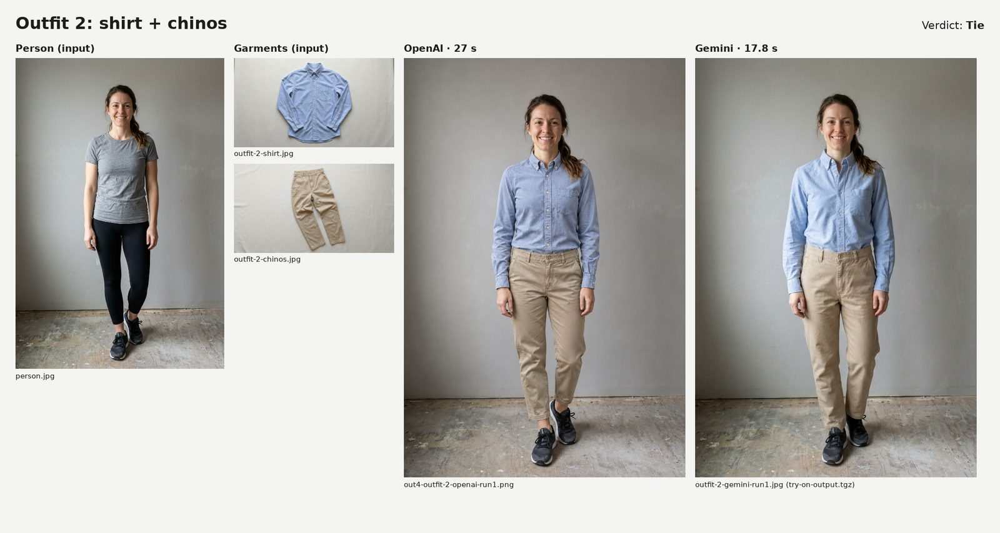
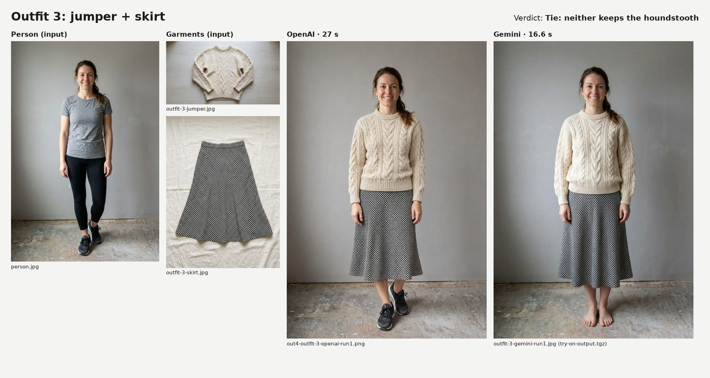
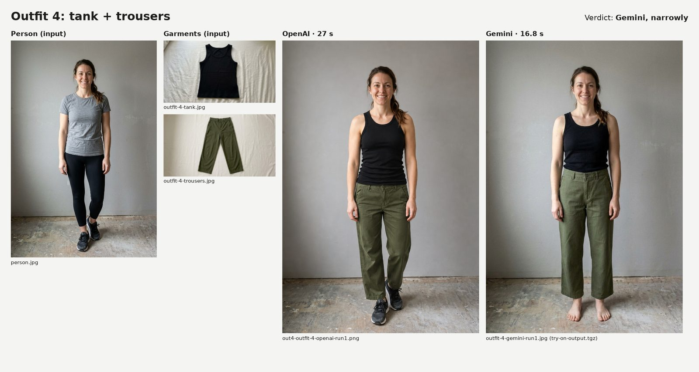
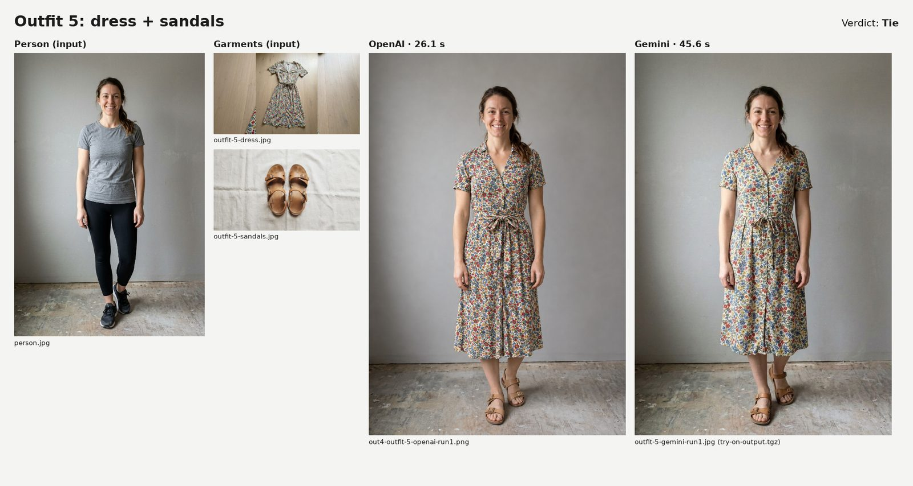

# Try-on v2 spike: OpenAI vs Gemini image-edit comparison

Write-up for ticket 1 of `docs/try-on-v2-brief.md` (Paperclip KAS-664, batch KAS-651). It is the team's recommendation, **not a decision**: Kasper picks the model.

## Short version

- **Picture quality is a dead heat.** UX/UI Junior scored OpenAI 108 and Gemini 107 out of 125. They differ in kind. Gemini dresses the person more faithfully (garment 22 vs 17, fit 22 vs 19). OpenAI keeps the original photo more faithfully and more sharply (photo kept 25 vs 19).
- **Gemini is faster** (typical 17.8 s vs 27.0 s) and **cheaper** (about US$0.045 vs about US$0.11 per try-on, both estimates).
- **Photo retention is similar:** OpenAI keeps logs up to 30 days, Gemini 55 days. Neither trains on paid API data.
- **Neither handled the small houndstooth skirt.** Both are unproven on consistency (one run each).
- **Team recommendation: Gemini (`gemini-nano-banana-2.1`), narrowly.** Details in the last section.

## Method

- **Models:** OpenAI `gpt-image-2.6-sunburst`; Google `gemini-nano-banana-2.1`. Checked 25 Nov 2026.
- **Inputs:** one made-up person photo (a computer-generated adult) and made-up garment photos only: 5 outfits, 11 garments (outfit 1 top, jeans, trainers; 2 shirt, chinos; 3 jumper, skirt; 4 tank, trousers; 5 dress, sandals). No real person or real customer data.
- **Runs:** **one run per outfit per model** (10 pictures). Each call made one picture, through the studio's paid-run gateway, within the US$5 cap.
- **Same prompt for both models:**

  > Edit the first picture, which shows a person. Keep the person's face, body, pose and background exactly as they are. Dress the person in the garments shown in the other pictures. Keep each garment's colour, pattern, fabric and hardware (buttons, belt loops, pockets, zips) exactly as photographed. Dress them naturally: tuck or untuck each garment as it suits. Leave the feet bare unless shoes are shown in the other pictures. Return one photo-realistic picture of the person wearing the outfit.

- **The `input_fidelity` change:** the harness first sent `input_fidelity: high` to OpenAI. `gpt-image-2.6-sunburst` rejects that setting, so commit `0da6283` (KAS-685) removed it. **All OpenAI pictures here were made without it**, at `quality: high`. OpenAI might do better on garment fidelity with a setting that does exist; that was not tried.
- **Scoring:** UX/UI Junior judged by eye, at full size and in close-ups, next to the inputs. 5 = can't fault it, 4 = small issue, 3 = noticeable, 2 = a shopper would mind, 1 = unusable. Five equal-weight criteria: likeness, garment, fit and tuck, photo kept, flaws. One judge only.
- **Timings:** from `out4-results.json` (KAS-664). Prices and terms: the Researcher's report (KAS-652), read 25 Nov 2026.
- Harness: `apps/web/scripts/try-on-spike/`.

## Side-by-side pictures

Each sheet shows the person, the garments, the OpenAI result and the Gemini result. Open on a phone and zoom.

| Outfit | Sheet | Verdict (UX/UI Junior) |
| --- | --- | --- |
| 1 top, jeans, trainers | [outfit-1-sheet.jpg](try-on-v2-spike/outfit-1-sheet.jpg) | Gemini, narrowly |
| 2 shirt, chinos | [outfit-2-sheet.jpg](try-on-v2-spike/outfit-2-sheet.jpg) | Tie |
| 3 jumper, skirt | [outfit-3-sheet.jpg](try-on-v2-spike/outfit-3-sheet.jpg) | Tie, neither acceptable |
| 4 tank, trousers | [outfit-4-sheet.jpg](try-on-v2-spike/outfit-4-sheet.jpg) | Gemini, narrowly, on the garments |
| 5 dress, sandals | [outfit-5-sheet.jpg](try-on-v2-spike/outfit-5-sheet.jpg) | Tie |







The sheets are reduced copies (1600 px wide JPEG) of UX/UI Junior's sheets on KAS-691.

## Scores (1-5, source: UX/UI Junior's `spike-judgement` on KAS-691)

| Outfit | Model | Likeness | Garment | Fit and tuck | Photo kept | Flaws | Total /25 |
| --- | --- | --- | --- | --- | --- | --- | --- |
| 1 | OpenAI | 5 | 4 | 3 | 5 | 5 | 22 |
| 1 | Gemini | 5 | 5 | 5 | 4 | 4 | 23 |
| 2 | OpenAI | 5 | 4 | 4 | 5 | 5 | 23 |
| 2 | Gemini | 5 | 5 | 4 | 5 | 4 | 23 |
| 3 | OpenAI | 5 | 2 | 4 | 5 | 3 | 19 |
| 3 | Gemini | 5 | 3 | 4 | 3 | 4 | 19 |
| 4 | OpenAI | 5 | 4 | 4 | 5 | 5 | 23 |
| 4 | Gemini | 5 | 5 | 5 | 3 | 4 | 22 |
| 5 | OpenAI | 5 | 3 | 4 | 5 | 4 | 21 |
| 5 | Gemini | 5 | 4 | 4 | 4 | 3 | 20 |
| **All five** | **OpenAI** | 25 | 17 | 19 | 25 | 22 | **108** |
| **All five** | **Gemini** | 25 | 22 | 22 | 19 | 19 | **107** |

## The brief's six points, per model

| Point | OpenAI `gpt-image-2.6-sunburst` | Gemini `gemini-nano-banana-2.1` | Source |
| --- | --- | --- | --- |
| **1. Person likeness** | 25/25. Face, hair, skin and build matched in all five. | 25/25. Matched in all five (once a touch paler). | KAS-691 scores |
| **2. Garment fidelity** | 17/25. Crisp, but it quietly restyles: crops and tapers trousers, rolls hems, narrows the tank straps, enlarges the dress print. On outfit 3 the skirt's houndstooth became a warped dot grid. | 22/25. Truer colour, cut, leg shape, print scale and strap shape. On outfit 3 the skirt became a grey checkerboard (wrong motif, but no warping). The dress tie belt came out as a thin cord. | KAS-691 scores and notes |
| **3. Fit** | 19/25. Natural, but outfit 1 hangs boxy and untucked. | 22/25. Natural front tucks and rise. | KAS-691 scores |
| **Background / photo kept** (brief's fourth score) | 25/25. Pose, wall, floor, light and the person's own trainers kept every time. Sharper (1027x1531 PNG). | 19/25. Softer (848x1264 JPEG, the input size) and slightly cooler light. On outfits 3 and 4 it redrew the stance with bare feet side by side. | KAS-691 scores; file sizes from `out4-results.json` |
| **4. Price per try-on** | No published per-picture price (bills per token: image in US$8.00, image out US$30.00 per 1M tokens). **Estimate about US$0.11** for 1 person + 4 garment pictures in, 1 out (about US$0.05 out, about US$0.06 in). Weak: it rests on community measurements. | **US$0.0336 per 1K picture** (US$0.0504 at 2K), input US$1.50 per 1M tokens. **Estimate about US$0.045** per try-on. Batch is half price. | KAS-652 (pricing pages, OpenAI community threads) |
| **5. Speed** (one picture per call) | p50 27.0 s, p95 27.0 s. Range 26.1-27.0 s over 5 calls. | p50 17.8 s, p95 45.6 s. Range 16.6-22.7 s, plus one slow call of 45.6 s on outfit 5. | `out4-results.json` (5 calls each). Neither provider publishes a speed figure (KAS-652). |
| **6. Photo retention** | Not used for training. Abuse-monitoring logs kept up to **30 days**; nothing kept as application state. Zero retention needs OpenAI sales approval and the 2.6 models are **not** on the eligible list (the 2.5 models are). Image inputs are scanned for abuse. | Paid tier not used for training. Prompts and outputs logged up to **55 days** for abuse checks, and flagged content may be read by Google staff. Stored "transiently or cached in any country". No zero-retention option found. **Only a billed Google project is acceptable**: the free tier trains on data and humans may read it. Terms bar apps likely to be used by under-18s. | KAS-652 (OpenAI data controls; Gemini API terms and abuse-monitoring pages) |

Other facts from KAS-652, for the later tickets: OpenAI takes up to 16 input pictures (each under 50 MB, from the 2.5 API spec; 2.6 wording not confirmed) and needs API Organization Verification. Gemini takes up to 14 reference pictures; its largest input size was not found. Neither offers a dependable seed for image edits. All Gemini output carries a SynthID watermark.

## What isn't known

- **Consistency.** One run per outfit per model, so there is no view of how much results vary between runs or how often either model fails.
- **OpenAI price per picture.** OpenAI publishes none. The US$0.11 is the Researcher's inference from community measurements, and the first-call `usage` figures were not checked against it.
- **Real spend.** Each provider's billing page shows what the runs actually cost. The studio can't see those pages, so the real spend is **not verified**.
- **Other people.** One made-up adult woman, standing straight on. Other body types, skin tones, poses and real phone photos are untested.
- **Judging.** One designer's eye, no second judge, equal weights in the totals. Judged on screen and in close-ups, not in the Fashun app.
- **Refusals.** What each model declines on real-person photos is not documented and wasn't tested with real people.
- **Prompt effects.** Whether changing the "bare feet" line stops Gemini moving the legs, and whether OpenAI does better with a different setting than the one `0da6283` removed.
- **Gemini gaps:** largest input picture, input-picture token count, and whether 1024x1536 bills as a 1K picture. **OpenAI gaps:** regions, and the 2.6 input limits.

## Recommendation (the team's, not a decision)

UX/UI Junior's verdict, quoted from KAS-691:

> **Overall recommendation: Gemini, narrowly.** A try-on is there to show the shopper *the garment they're buying*. Gemini kept the garments truer: colour, cut, leg shape, print scale and strap shape. It also tucked and styled them naturally, scoring 22 against 17 on garment fidelity and 22 against 19 on fit. Those are exactly the faults that sank FASHN (wrong patterns and a boxy, untucked fit). It was also faster: 17-23 s against about 27 s, with one slow call of 46 s on outfit 5.
>
> **What OpenAI does better:** sharper pictures, and it never moves the person (25 against 19 on keeping the photo). But it quietly restyles garments […] On outfit 3 it warped the skirt pattern, the same flaw as FASHN.

The Engineer adds, from KAS-652's facts: Gemini is also the cheaper option by about half on the estimates, and its terms are close to OpenAI's (55 vs 30 days of logs). Two things need planning if Gemini is chosen:

1. **Billed project and age gate.** Photos must only go through a billed Google project, and Fashun needs an 18+ gate or terms.
2. **Softer pictures and stance changes.** Fine at phone size, softer when zoomed. A prompt change to keep the person's own shoes might stop the stance changes (not tested).

**What would change the recommendation:** repeat runs showing Gemini is inconsistent (a warped pattern, a changed face) or OpenAI keeping garments true more often; large or zoomable pictures on desktop, where OpenAI's sharpness counts more; or a prompt change that doesn't stop Gemini moving the legs.

**For the later tickets, if Gemini is chosen:** `TRY_ON_PRICE_USD` about 0.045 (estimate; check the billing page after real use), a `maxDuration` that covers the 46 s slow call with margin, and a privacy note that says Google keeps prompts and outputs up to 55 days and may process them in any country. FASHN stays behind a switch until Kasper decides.

## How to run the harness

```
export OPENAI_API_KEY=...   # never commit or paste keys
export GEMINI_API_KEY=...
node apps/web/scripts/try-on-spike/run.mjs <photo-folder> --out try-on-spike-out --runs 5
```

Photo folder: `person.jpg`, `outfit-1/top.jpg`, `outfit-1/bottom.jpg`, ... `outfit-5/` (`.jpg`, `.png` or `.webp`). Add `--dry-run` to check the flow without keys or network. Override models with `--openai-model` / `--gemini-model` (or `OPENAI_IMAGE_MODEL` / `GEMINI_IMAGE_MODEL`). Output: every returned picture, `outfit-N-sheet.html`, and `results.json`. The spike run itself went through the studio gateway with one request per picture, using base addresses set by `OPENAI_BASE_URL` and `GEMINI_BASE_URL`.
